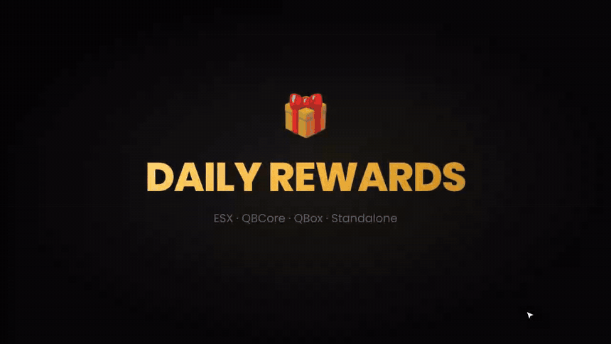
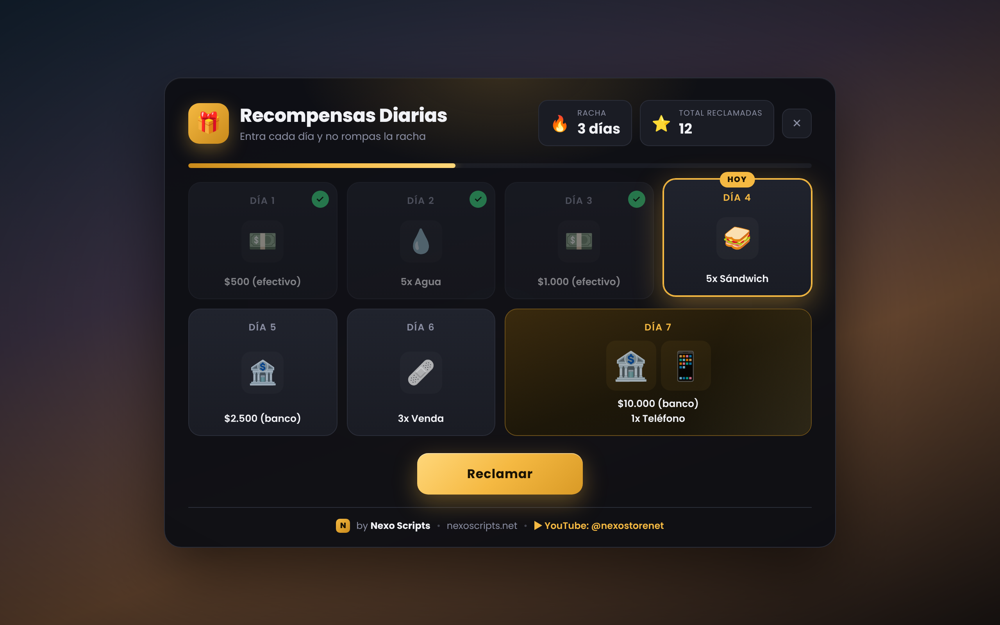
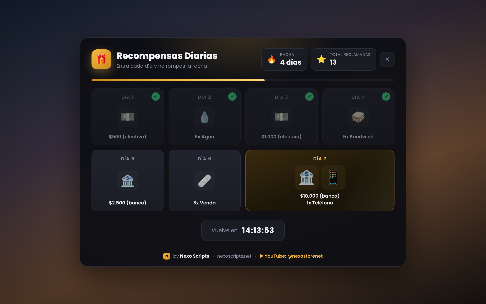
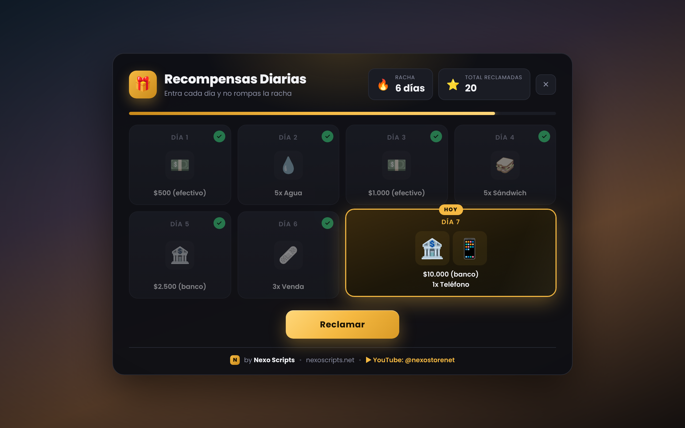

<div align="center">

# 🎁 Daily Rewards — FiveM

**Recompensas diarias con rachas para tu servidor de FiveM.**
Compatible con **ESX · QBCore · QBox · Standalone**. Sin SQL. 100% gratis.



🎬 [Ver tráiler en MP4](docs/trailer.mp4)

### Hecho por **[Nexo Scripts](https://nexoscripts.net/en)**

[](https://www.youtube.com/@nexostorenet)
[](https://nexoscripts.net/en)

**¡Suscríbete al canal para más scripts gratis!**

</div>

---

## ✨ Características

- 📅 **Ciclo de recompensas configurable** (7 días por defecto, pon los que quieras)
- 🔥 **Sistema de rachas**: si el jugador se salta un día, vuelve al día 1 (opcional)
- 🏆 **Carta especial** para el último día del ciclo
- 🧩 **Multi-framework automático**: detecta ESX, QBCore, QBox o funciona en standalone
- 🎒 **Inventarios**: ox_inventory, qb-inventory, ps-inventory (muestra la imagen real del item)
- 🔔 **Notificaciones**: ox_lib, ESX, QBCore o nativas de GTA
- 💾 **Sin base de datos**: usa el KVP de FiveM, solo arrastra y listo
- 🛡️ **Seguro**: todo se valida en el servidor, sin duplicados
- 👤 Racha **por personaje** o **por cuenta**
- ⏰ Cuenta atrás hasta la próxima recompensa
- 🎉 Animaciones y confeti al reclamar
- 🌍 Español e inglés
- 🔌 Recompensas **custom** (VIP, vehículos, lo que quieras vía evento)

## 📸 Capturas

| Disponible | Reclamada | Día 7 |
|---|---|---|
|  |  |  |

## 📦 Instalación

1. Descarga el repositorio (**Code → Download ZIP**) o desde [Releases](../../releases).
2. Pon la carpeta `dailyrewards` en tu carpeta `resources`.
3. Añade en tu `server.cfg` **después** de tu framework e inventario:
   ```cfg
   ensure dailyrewards
   ```
4. (Opcional) Permiso para el comando de admin:
   ```cfg
   add_ace group.admin command.dr_reset allow
   ```

## 🎮 Uso

| Acción | Por defecto |
|---|---|
| Abrir menú | `/recompensas` o **F7** |
| Reiniciar racha de un jugador (admin) | `/dr_reset <id>` |

## ⚙️ Configuración

Todo se hace en `config.lua`:

```lua
Config.Rewards = {
    { rewards = { { type = 'money', account = 'cash', amount = 500 } } },
    { rewards = { { type = 'item',  name = 'water', amount = 5, label = 'Agua' } } },
    -- ...
    {
        highlight = true, -- carta dorada
        rewards = {
            { type = 'money', account = 'bank', amount = 10000 },
            { type = 'item',  name = 'phone', amount = 1, label = 'Teléfono' },
        }
    },
}
```

**Tipos de recompensa:**

| Tipo | Ejemplo |
|---|---|
| `money` | `{ type = 'money', account = 'cash', amount = 500 }` (`cash` o `bank`) |
| `item` | `{ type = 'item', name = 'water', amount = 5, label = 'Agua' }` |
| `custom` | `{ type = 'custom', event = 'mi_script:darVip', label = 'VIP', icon = '👑', data = {} }` |

Las recompensas `custom` lanzan `TriggerEvent(event, source, data)` en el servidor.

### Standalone
Si no usas framework, conecta tu sistema en `Config.Standalone.AddMoney` y `Config.Standalone.AddItem`.

## 🔧 Para desarrolladores

```lua
-- Export (servidor): racha actual del jugador
local racha = exports.dailyrewards:GetStreak(source)

-- Evento (servidor): cuando alguien reclama
AddEventHandler('dailyrewards:claimed', function(src, day, streak)
    print(('%s reclamó el día %s (racha %s)'):format(GetPlayerName(src), day, streak))
end)
```

## 📜 Licencia

Gratis y de código abierto bajo licencia **MIT**. Puedes usarlo y modificarlo.
Si lo compartes, mantén los créditos 🙏

---

<div align="center">

### ⭐ Si te sirve, deja una estrella y suscríbete a **[Nexo Scripts en YouTube](https://www.youtube.com/@nexostorenet)** ⭐

🌐 Más scripts en **[nexoscripts.net](https://nexoscripts.net/en)**

</div>
